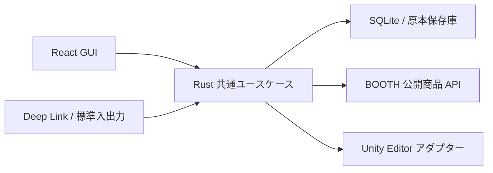

# omnooth

2026-10-27 に本体の開発を開始した。Tauri / React の本体、Rust の原本保存・ローカル取り込み・プロジェクト登録、独立した Unity アダプターを追加した。起動方法と現在の制約は [本体の開発資料](desktop/README.md)、次の作業は [実装計画](docs/implementation-plan.md) を参照する。Unity 適用、BOOTH / Deep Link、依存・競合・復旧などは引き続き実装途中。

次のセッションでは、まずこの README、[レビューアプリの開発資料](design-review/README.md)、`design-review/data/catalog.mjs` を読む。ここに記録した最新のユーザー指示を、過去の仕様・レビュー返信より優先する。

## 最新の指示と今回の範囲

- **Figma は最新の開発依頼に基づく参照のみ。** 2026-10-27 の明示指示で最新デザインを読み、本体に取り込み始めた。Figma の編集・コメント操作は行わない。
- レビュー画面のモックと古い参照画像は削除した。復元・再生成しない。以前の Figma 編集記録は履歴であり、現在の画面デザインの正本ではない。本体の新規 UI とローカルアセットは `desktop/` に分離した。
- **Unity に適用する単位は `.unitypackage` のみ。** 配布 ZIP 等の中から、適用する unitypackage を個別に選ぶ。複数件の順序を扱う。
- **PNG / PSD などの直接追加は対象外。** ファイルの直接コピー、専用配置先、PSD 変換・編集、Material への自動割当を実装しない。unitypackage の内部に含まれるテクスチャ等は通常のインポート対象。
- **インポート先パスの変更は対象外。** unitypackage が定義する Assets パスを使う。配置テンプレート、パスのリマップ、`MoveAsset`、元の配置へ戻す操作を実装しない。ライブラリ保存先の変更は別の設定であり、残す。
- 生成 AI に関する機能・クラウド API は対象外。以前の Cloudflare / Hono / AI SDK / Haiku 案を再導入しない。
- 2026-10-27 の次の依頼で開発開始が許可された。詳細作業を GPT-6 Luna のサブエージェントへ委任し、主担当が統合と検証を行う。
- application ID は `dev.tuki.omnooth`。BOOTH Deep Link の受信先を既存登録ごと設定し直せる操作を一般設定へ追加した。受信通知まで実装済みで、ダウンロードと永続キューは後続。
- 一般／バージョン履歴は明示的なタブで切り替える。連携専用画面は現時点では置かず、マニュアルは `https://omnooth.tuki.dev/docs` を開く。

現行の設計カタログは `2026-10-27.2`。削除した設計項目は `archivedSpecs` に本文を持たない履歴用レコードだけを残している。SQLite にある過去の発言・承認を消さない。通常の承認は利用者が行う。2026-10-27 の明示的なオートレビュー依頼では、対象と根拠を記録したうえで委任された項目を承認する。以後の自動承認を包括的に許可するものではない。

## リポジトリにあるもの

| パス | 状態と役割 |
| --- | --- |
| `desktop/` | Tauri 2 + React / TypeScript の初期本体。設定・ローカル取り込み画面 |
| `crates/omnooth-core/` | 本体用 SQLite、原本保存庫、プロジェクト検証、共有 command dispatcher |
| `crates/omnooth-unity/` / `unity/` | 未接続の Unity アダプター。実インポートの動作確認は未完了 |
| `design-review/` | 実行可能な React / Vite + Node の設計レビューアプリ |
| `design-review/data/catalog.mjs` | 要件、関数契約、将来の DB、根拠、フローの本文 |
| `design-review/src/domain/package-version.ts` | 日付と SHA-256 による版識別の参照実装。テスト済み |
| `design-review/src/domain/booth-metadata.ts` | BOOTH JSON の検証・DTO 変換・ファイル更新日時照合の参照実装 |
| `design-review/src/domain/library-content.ts` | unitypackage の列挙・明示選択・順序・入力検証の参照実装 |
| `design-review/server/store.mjs` | **レビュー用** SQLite。comments / decisions の保存と改訂検知 |
| `design-review/data/reviews.sqlite` | レビューの正本。Git 対象外。同じワークスペースで継続する |
| `design-review/data/review-snapshot.json` | 自動書き出し。Git 対象外 |
| `design-review/data/figma-changes-2026-10-23.json` | 過去の操作記録。現在のデザインへの再適用は禁止 |
| `dist/omnooth` | 作業開始前からあるバイナリ。上書き・削除しない。現在の設計が実装済みという根拠にしない |

`catalog.mjs` の関数は TypeScript 表記の**契約**であり、その名前の Rust 実装が既にあるわけではない。ER 図の17テーブルは本体用の設計で、レビュー DB にマイグレーション済みではない。レビューアプリも本体の製品 UI ではない。本体の ja / en / ko 対応と、現在の日本語のレビュー UI も区別する。

## 確定した本体の設計

### 構成

Tauri 2 + React / TypeScript、ローカル処理は Rust。GUI・Deep Link・ブラウザ / Unity 拡張の標準入出力アダプターは、同じコマンド DTO と application service を使う。検証・キュー・DB・権限判定を入口ごとに複製しない。キューと DB の所有者は単一起動の本体。

以下は到達予定の構成。GUI と Rust のローカル取り込みは初期実装があり、BOOTH / 拡張 / Unity 適用の本体接続は後続。



本体用 SQLite はメタデータ、原本は SHA-256 による保存庫で管理する。初期実装は `appData/omnooth.sqlite`、`Library/objects/<sha256>` と展開内容を保存する。適用用の staging / backups と全17テーブルの整合性は後続。Rust の初期マイグレーションと GUI の IPC は追加済み。

### 取り込みと適用

- `booth-library-manager://item-import` を起動時・実行中に受信し、永続 FIFO キューに入れる。実行可能ジョブを1件ずつ処理する。
- `dlurl` は署名付き URL。`downloadable_filename`、`item_id`、任意の `variation_id` と `order_id` を読み、空の `order_id` は null にする。署名 URL やパスワードを資料・ログへ残さない。
- 期限切れ・拒否は新 URL の受信待ちにし、他の実行可能ジョブを止めない。重複受信は同じジョブへまとめる。再起動時に原本・登録結果・キューを照合する。
- ZIP / 7z / RAR / tar / tar.gz・tgz / tar.bz2・tbz2 / tar.xz・txz が取り込み対象。形式・暗号方式の実ファイル検証は未実施。libarchive は候補で、まだ組み込んでいない。
- 圧縮ファイルの展開は設定に依存する。初期案は OFF。受付時にジョブへ設定をコピーし、以後の設定変更で受付済みジョブを変えない。OFF は原本保存だけで完了。後から明示的に展開できる。
- **ライブラリ登録の成功と Unity 適用の成功は別。** 展開済みでも unitypackage がなければ適用不可。その他の収録物は原本を失わず、直接適用はしない。
- 配布原本の版と、その中の unitypackage の選択を分ける。全件を勝手に選ばず、PC / Quest の文字から依存や排他を推測しない。unitypackage 内部の部分選択は初版の対象外。
- Unity プロジェクトは VCC / ALCOM 等で作成し、初回起動済みの既存フォルダーを登録する。Assets がない場合は拒否する。本体はプロジェクトを作成しない。
- 計画で追加・削除・更新を確認する。パッケージ全体の削除は `removePackageIds` で明示し、空選択や部分更新と区別する。保持するパッケージの依存も含めて検証する。`installItem` は確認した planHash を実行する。依存を先にし、選択した unitypackage を明示順に `AssetDatabase.ImportPackage(path, false)` へ渡す設計。完了・失敗・中断と実ファイルを照合してから DB・通知を確定する。
- パス・GUID の競合は停止して表示する。インポート先を変えて回避しない。所有権は `project_files.source_file_id` まで追跡し、共有する親フォルダーやユーザー変更済みのファイルを一括削除しない。
- 選択・所有台帳は所属を保証する複合 FK と参照用 UNIQUE を持ち、一括更新に必要な FK は COMMIT 時に検証する。失敗時の `recoverInstallation` とバックアップ照合は残す。対象外にした「元の配置へ戻す」という移動設定の復帰機能とは別。

### 版名・カスタム・表示

- 全ての版を `YYYY-MM-DD@sha先頭8文字` で表示し、内部識別には SHA-256 全長を使う。元名が `v1_3_0` / `ver1.01` 等でも版名を抽出しない。認識設定と版名の手入力を設けず、共通カスタムにも同じ規則を使う。版の日付は `package_versions.version_date` に保存し、同一内容の再取り込みでは初回の版を再利用する。
- 日付は variation ID と元ファイル名が一意に一致した BOOTH `downloadables.updated_at`、取れなければ取り込み日時の UTC 日付。商品の `published_at` をファイル更新日時へ流用しない。
- 共通カスタムは、ユーザーが用意した改変済み unitypackage と完全一致の必須依存を保存する。アプリ内の unitypackage 作成や素材の直接追加はしない。作成・編集・保存に projectId を要求せず、Unity への適用だけをプロジェクト選択後に行う。
- 表示上の親と必須依存は別。循環・欠損・同じ論理パッケージの版衝突を検出する。複数の unitypackage を含む必須依存でも暗黙に全件を適用しない。
- 本体は ja / en / ko。i18next による3言語の画面と保存済み言語の復元は初期実装済み。OS ロケールを本体の初回設定へ渡す処理は後続。目標は保存済み言語を OS より優先し、地域コードを正規化して未対応時は ja。
- 検索は空白 OR、`&&` AND を優先。`shop:` / `category:` / `tag:` / `is:starred` / `age:` 等を扱う。可視性条件は検索式全体の外側に AND でかける。
- 非表示機能は UI だけを隠し、ライブラリ原本を暗号化しない。初回に3言語で説明し了承を保存する。Unlock は macOS / Windows の OS 認証。Linux は操作を表示しない。署名 URL の保護は、この非表示機能とは別の処理。
- 初版の配布でコード署名・notarization を必須にしない。将来対応の設計。クラウド同期・アカウント・自動購入も初版の対象外。

## 続く実装の順序

1. この文書、本体 README、レビューアプリ README、カタログと保存済みレビューを読む。削除した機能を戻さず、Figma は参照のみとする。
2. Tauri / Rust の最小構成とローカル保存処理は追加済み。既存 Unity プロジェクトへの Editor 接続・非対話 ImportPackage・完了通知の実機検証を続ける。Unity の対象バージョンは登録プロジェクトから読む。
3. 本体の型付き契約、DB マイグレーション、原本保存庫を実装する。レビュー DB と分ける。参照関数の入出力ケースを Rust へ引き継ぐ。
4. 取り込みキューと安全な展開、unitypackage の選択、計画・競合検出、適用・確定・復旧を接続する。その後に本体 UI・拡張・i18n を接続する。

Unity アダプターの通信・導入、unitypackage 内部マニフェストの安全な解析、展開ライブラリの OS / 暗号方式対応、デスクトップ OS 認証は未検証。テスト済みと扱わず、実装の境界ごとに確認する。特に Tauri の公式 Biometric を macOS / Windows 用と決めつけない。

公開 BOOTH API は 2026-10-22 に商品 7328764 / 8596249 の HTTP 200 と実フィールドを確認済み。縮小フィクスチャを保存した。全商品・認証付き取得・サービスの安定性を検証したわけではない。

## レビューアプリの起動・検証

Node.js 24 と pnpm を使う。依存導入や開発用ポート、レビューの読み方、Node による代替コマンドは [design-review/README.md](design-review/README.md) に記載。

```sh
pnpm --dir design-review install
pnpm dev
pnpm test
pnpm build
```

開発画面は <http://127.0.0.1:4310/>、API は 4311。ビルド済み画面は `pnpm start` で 4310 に配信する。手元の変更は未コミットなので、既存作業を消す `git reset` / `git clean` やレビュー DB の初期化を行わない。
