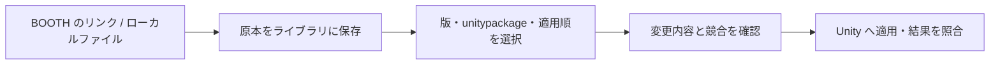

<p align="center">
  
</p>

# omnooth

**BOOTH で入手した Unity 向けアセットを、原本の保存からプロジェクトへの適用まで管理するデスクトップアプリです。**

配布ファイルをローカルのライブラリに保存し、版ごとに整理します。配布物に含まれる `unitypackage` を選び、変更内容を確認してから既存の Unity プロジェクトへ適用できます。

[操作ガイド](docs/unity-installation.md) · [リリース](https://github.com/tukiminya/omnooth/releases) · [不具合報告](https://github.com/tukiminya/omnooth/issues) · [Apache License 2.0](LICENSE)

> 現在開発中で、公開インストーラーの提供前です。動作を試す場合は [ソースから起動する](#ソースから起動する) を参照してください。macOS（Apple Silicon）/ Unity 2022.3.22f1 での実機検証を進めており、Windows / Linux での実動作確認は継続中です。確認済みの範囲と残る制約は [検証記録](docs/implementation-validation.md) を参照してください。

## 主な機能

- **BOOTH からの取り込み** — BOOTH Library Manager 形式のリンクを受信し、順番にダウンロードして商品情報とともに登録します。同じファイルの重複受信をまとめます。
- **原本と版の管理** — 原本を SHA-256 で識別し、版を `YYYY-MM-DD@ハッシュ先頭8文字` で表示します。同じ内容の再取り込みでは既存の版を再利用します。
- **圧縮ファイルへの対応** — ZIP / 7z / RAR / tar / tar.gz / tar.bz2 / tar.xz と別名拡張子に対応します。ZIP / 7z / RAR のパスワードは展開時だけ使用します。
- **unitypackage の明示選択** — 配布物に含まれる複数の `unitypackage` を個別に選び、適用順を指定できます。ZIP は全体を展開せずに内容を確認・選択できます。
- **確認してから Unity へ適用** — 変更予定とパス・GUID の競合を確認し、適用後の実ファイルを照合します。バックアップ、適用履歴、失敗時の復旧にも対応します。
- **共通カスタムと依存管理** — 用意済みの改変済み `unitypackage` と、完全一致の版を指定した必須依存を保存できます。作成・編集はプロジェクト未選択でも行えます。
- **商品情報と検索** — 商品情報・タグ・お気に入りを編集し、キーワードやショップ・カテゴリなどの条件を組み合わせて検索できます。
- **表示と保存先の設定** — 日本語・英語・韓国語、ライブラリ保存先、展開設定、確認付きの旧版整理を利用できます。macOS / Windows では OS 認証による非表示アイテムの解除を扱います。

## 利用の流れ



1. VCC / ALCOM などで作成し、Unity で初回起動を済ませた既存プロジェクトを登録します。
2. ローカルの配布ファイルを追加するか、BOOTH のダウンロードリンクを開いてライブラリへ取り込みます。リンクを使う場合は、一般設定から「BOOTH リンクの受信先に設定」を実行してください。
3. 版と適用する `unitypackage` を選び、順番を決めます。
4. 対象プロジェクトを Unity で開きます。初回は確認画面から Unity アダプターを導入し、変更予定を確認して適用します。

詳しい操作は [Unity への適用](docs/unity-installation.md) を参照してください。配布状況は [GitHub Releases](https://github.com/tukiminya/omnooth/releases) から確認できます。

## データの扱いと動作範囲

- 原本と管理データはローカルに保存します。BOOTH からのダウンロードと公開商品情報の取得にはネットワーク接続を使用します。
- Unity へ適用する単位は `unitypackage` です。PNG / PSD などの直接追加や、パッケージが定義する `Assets` パスの変更は扱いません。
- ライブラリへの登録と Unity への適用は別の操作です。保存・展開だけではプロジェクトを変更しません。
- 非表示機能はアプリ内の表示を隠します。保存ファイルは暗号化されず、Finder やエクスプローラーから閲覧できます。Linux では非表示の操作を表示しません。
- BOOTH の署名付きダウンロード URL は、OS 資格情報で保護した鍵を使って暗号化します。再起動後に安全な再開を確認できない場合は、新しいリンクを待ちます。

## ソースから起動する

### 必要な環境

- Node.js 24
- pnpm 12.3.4
- Rust と [OS ごとの Tauri 2 開発環境](https://v2.tauri.app/start/prerequisites/)
- 適用先プロジェクトに対応する Unity Editor

```sh
git clone https://github.com/tukiminya/omnooth.git
cd omnooth
pnpm install --frozen-lockfile
pnpm app:dev
```

### 検証とビルド

```sh
# TypeScript の型チェックとフロントエンドのビルド
pnpm app:check

# Rust のテスト
pnpm app:test

# 画面テスト（初回は Chromium をインストール）
pnpm --dir desktop exec playwright install chromium
pnpm --dir desktop test

# 本体のビルド（インストーラーは生成しません）
pnpm app:build
```

OS ごとの注意点や起動オプションは [本体の開発資料](desktop/README.md) を参照してください。

## ドキュメントと構成

| 資料 | 内容 |
| --- | --- |
| [Web マニュアル（準備中）](https://omnooth.tuki.dev/docs) | 利用者向けの操作案内を整備予定 |
| [本体の開発資料](desktop/README.md) | 開発環境、起動方法、実装の制約 |
| [Unity への適用](docs/unity-installation.md) | アダプターの導入、適用・復旧の仕組み |
| [実装計画](docs/implementation-plan.md)・[検証記録](docs/implementation-validation.md) | 現在の実装範囲と確認状況 |
| [配布手順](docs/releases.md) | OS ごとのビルドとリリースの流れ |
| [開発の引き継ぎ](docs/development-handoff.md) | 確定仕様、継続作業の注意点 |

| パス | 役割 |
| --- | --- |
| `desktop/` | Tauri 2 + React / TypeScript のデスクトップ本体 |
| `crates/omnooth-core/` | Rust の共通処理、SQLite、原本保存、適用計画 |
| `crates/omnooth-unity/`・`unity/` | Unity Editor との通信と適用用アダプター |
| `design-review/` | 要件・設計・レビューを管理する開発用アプリ |

開発時の作業ルールは [AGENTS.md](AGENTS.md)、設計レビューアプリの起動方法は [design-review/README.md](design-review/README.md) に記載しています。

## 不具合報告

[GitHub Issues](https://github.com/tukiminya/omnooth/issues) に、アプリ・OS・Unity のバージョン、再現手順、期待した動作を記載してください。ログを添付する場合は、署名付き URL・注文 ID・パスワードなどの機密情報を除いてください。

## ライセンス

omnooth のソースコードは **[Apache License 2.0](LICENSE)** で公開しています。

同梱フォントや第三者のコード・テストデータには、それぞれのライセンスが適用されます。[同梱ライセンス](desktop/public/licenses/) と [テストデータの出典・ライセンス](crates/omnooth-core/tests/fixtures/README.md) を参照してください。BOOTH などから取り込む配布物は、各作者の利用規約・ライセンスに従って利用してください。

---

omnooth は BOOTH を運営するピクシブ株式会社とは関係のない、非公式のツールです。
