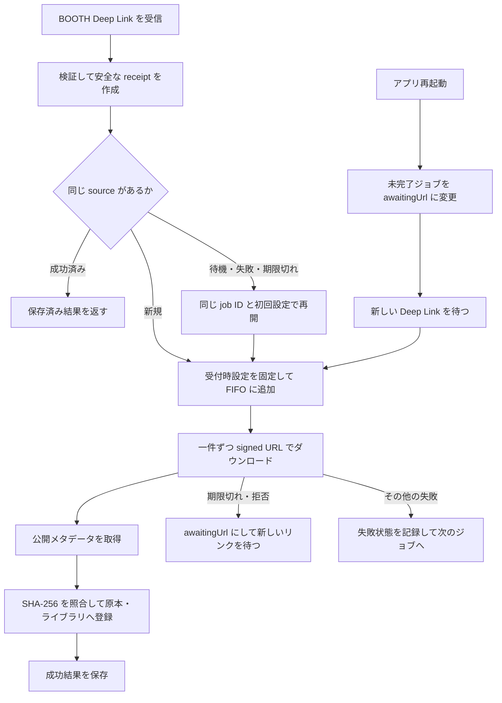

# omnooth 実装計画

2026-11-06 時点の本体実装状況を記録する。現行カタログ、ユーザーからの最新指示、保存済みレビューを基準とし、レビュー DB と作業開始前からある `dist/omnooth` は変更しない。

## 現在の実装

- Tauri 2 / React / TypeScript のデスクトップ本体と Rust の共通 application service。
- SQLite の初期スキーマ、既存 Unity プロジェクトの検証・登録、SHA-256 による原本保存、版識別、ローカルファイルの取り込み・展開。
- 未展開 ZIP の内容一覧・検索と unitypackage の明示選択。共通 `inspectArchive` command は解凍せずに収録情報を読む。一時取り出し・成功時削除は独立 Unity アダプターに追加した。本体の適用全体と Unity 実機での確認は未完了。[ZIP の実装と検証](zip-import.md) を参照する。
- `booth-library-manager://item-import` を受ける永続 FIFO。署名 URL はプロセスメモリーだけに置き、永続 JSON には安全な receipt、ジョブ ID、受付時設定、状態、エラーコード、ローカル item ID を保存する。
- BOOTH 原本のダウンロード、公開メタデータ取得、SHA-256 照合、原本・ライブラリ登録。variation ID と元ファイル名に一致する公開日時が一意に得られない場合は、取り込み日時を版の日付に使う。
- 同じ `sourceIdentity` の受信を既存ジョブにまとめる。成功済み source の再通知では既存結果を返し、再ダウンロードしない。
- ジョブの `libraryPath` と `extractArchives` は受付時に固定する。失敗または期限切れは新しい Deep Link を待つ。再起動後の未完了ジョブは `awaitingUrl` となり、同じ ID と初回設定で新しい URL から再開する。
- 起動、command、BOOTH 処理の活動ログを `appData/logs/` に保存する。URL や既知の秘密値を伏せ、サイズと保持期間を制限する。UI は現在のセッションのログを表示する。
- 独立 Unity Editor アダプターと初期本体 UI。ただし Unity の実 ImportPackage 結果を製品状態へ確定する処理は本体に接続していない。

署名 URL の OS 資格情報暗号化と、再起動後に URL の期限内で自動再開する機能は未実装。Firefox からエクの実ファイル受信・登録と重複防止は確認済み。ネイティブ UI の直接操作はツールの ID 認識エラーで未確認。詳細は [BOOTH 取り込み検証記録](booth-import-validation.md) に記録した。

## 次に進める項目

1. BOOTH の初回実ファイル検証は完了した。今後は操作ツールの ID 認識問題を解消してネイティブ UI を直接確認し、他 OS と他の配布ファイルでも受信・登録を検証する。
2. OS 資格情報を使った署名 URL の暗号化保管と、期限内の安全な自動再開を設計・実装する。現状のメモリー限定保持を暗号化済みとは扱わない。
3. ZIP 以外の圧縮形式と暗号化アーカイブの実際の対応形式・上限を確認する。
4. Unity アダプターの導入・通信を検証し、安全な unitypackage 解析、依存解決、planHash、パス・GUID 競合、所有台帳、バックアップ・適用・確定・復旧を接続する。Editor callback のみを成功確定と扱わない。
5. 共通カスタム、検索、OS 認証による表示制御、ブラウザ / Unity 拡張の共通コマンド接続を続ける。

## 検証の記録

統合テスト、型チェック、ビルドと BOOTH の実ファイル・UI 確認は [検証記録](booth-import-validation.md)、Unity の実動作制約は [本体 README](../desktop/README.md) と [Unity アダプター README](../unity/com.omnooth.editor/README.md) を参照する。

Figma の編集・コメント操作は行わない。削除済みレビュー画面モックや旧画像を復元しない。
