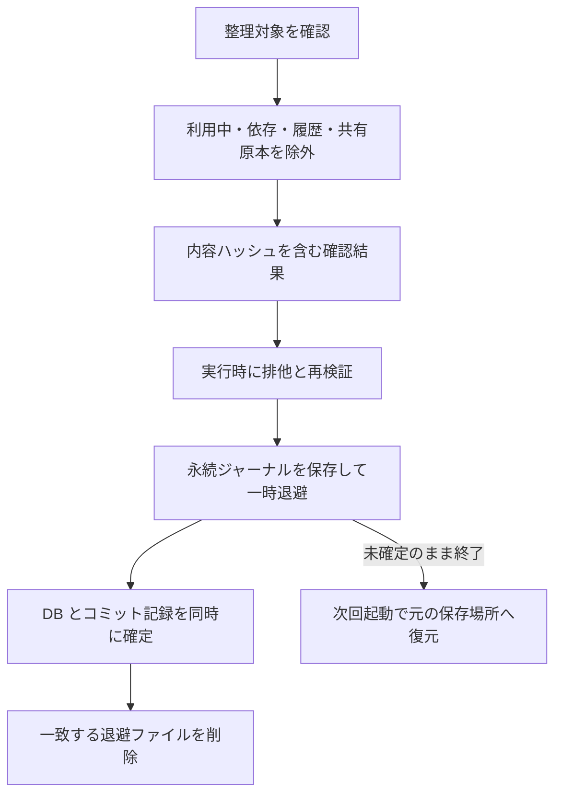

# 初期実装の検証記録

## 2026-11-18 — 残機能の段階実装と統合検証

外部拡張と配布を除く7ステップを順番に実装・検証し、それぞれを個別コミットした。Figma、レビュー DB・承認履歴、既存の `dist/omnooth`、配布ワークフローは変更していない。

- OS 優先言語と保存設定の優先、商品情報の永続化・編集、Unicode の大文字小文字を扱う検索、OR / AND・引用符・条件フィルター、更新履歴の限定抽出を追加した。
- 共通カスタムの内容マニフェスト、変更しない過去の版、完全一致依存の検証・編集、依存ファイルの明示選択と適用を接続した。
- 非表示の初回了承、バックエンドの認可と期限、キャッシュされた非表示画面の破棄を検証した。macOS LocalAuthentication / Windows Hello の対話認証アダプターは接続済み。実際の生体・パスコード認証は未確認。
- AES-256-GCM の別ジョブ・別鍵・改ざん拒否、機密値がキュー JSON に入らないこと、再起動後も同じジョブ・受付時設定で再開することを確認した。macOS Keychain に検証専用の新しい鍵を保存し、再読込・一致・削除する実機テストも成功した。
- tar / gzip / bzip2 / xz、パスワード付き ZIP / 7z / RAR、RAR5 の通常ファイルと暗号化ヘッダー、リンク・不正パス・大小文字衝突の拒否を確認した。RAR フィクスチャは出典とライセンスを同梱した。全形式・暗号方式の組合せを保証するものではない。
- 整理は明示確認・参照保護・共有原本の正規パス照合・展開時台帳の照合・未確定移動の起動時復元を検証した。未実行計画と完了バックアップの整理でも適用済み状態を保つ。
- Rust 通常テスト104件（core 単体51・適用統合19・ZIP9・Unity8・本体17）、Playwright 32件、設計レビューの既存32件が成功。OS ハンドラー変更、OS 資格情報、実商品入力の3件は通常実行では ignored。Keychain 1件と実商品入力2回は別途明示実行した。
- TypeScript、Vite、`cargo fmt --all --check`、`cargo clippy --workspace --all-targets --offline -- -D warnings`、デバッグ本体ビルドがすべて成功した。pnpm の通常 script 起動が応答しなかったため、導入済みの同等 CLI を直接実行した。依存取得は lockfile を維持して pnpm を使った。
- Unity 2022.3.22f1 / macOS の基本 fixture と `--extended` が成功。後者は Material・Prefab・スクリプトの実インポート、Material 参照、スクリプトのコンパイルとドメインリロード後の読込、完了通知・操作 ID・GUID と実バイト一致を確認した。
- 保存済みのエク193,013,311 bytes・霧雨154,409,068 bytes の unitypackage を一時コピーへ取り出して読み取り専用で解析し、内部アセット338件・262件を検証した。元 ZIP・DB・ユーザーの既存プロジェクトは変更していない。実商品の Editor コードも実行していない。
- 追加した文言を同梱フォントの軽量版へ反映した。全字形フォントも保持する。通知を閉じた直後に同じジョブを再試行する競合を修正し、該当画面テストを3回反復して成功した。

Windows / Linux の実機、実商品の Unity 適用、強制終了を伴うドメインリロード中の実復旧、非表示解除の実対話認証、ネイティブ画面の最終目視は残る確認項目。GitHub Actions と配布ビルドは今回の対象外で、ローカル結果と区別する。

整理時の流れは次のとおり。設定の保存だけでは削除しない。

## 2026-11-17 — Unity 適用の接続

- 共通 service の計画・実行・実ファイル照合・DB 確定・復旧と、本体の確認・適用管理 UI を接続した。詳細は [Unity 適用](unity-installation.md) を参照する。
- `cargo test --workspace --offline`: core 65件（単体39・適用統合17・ZIP9）、Unity adapter 8件、本体15件の計88件が成功。OS ハンドラーを変更する既存の1件は引き続き ignored。
- TypeScript と Vite ビルド、Tauri を含む `cargo check --workspace --offline`、`cargo build -p omnooth-desktop --offline`（デバッグ実行ファイル）、`cargo fmt --all --check` が成功。Playwright 全26件も成功し、適用の確認・順序・planHash・再試行・復旧を含む。
- Unity 2022.3.22f1 / macOS の一時プロジェクトで実 ImportPackage を実行し、要求・操作 ID、正常完了、asset / asset.meta の完全一致、GUID を確認した。ライセンス IPC の過去の失敗記録とは別の、今回成功した検証。実機の小さな自作テキスト fixture と VRChat 実商品全体は区別する。
- Unity が書き出した gzip / tar に含まれた PAX・AppleDouble を解析で扱い、パス・サイズの PAX 上書きは拒否する。共有フォルダーのメタデータ変更とユーザー作業のある新規フォルダーの復旧を停止する。完了通知後も Editor が idle になるまで成功を確定しない。
- ここに記載した結果はローカル実行。GitHub Actions、Windows / Linux の実 Unity、Prefab / Material とドメインリロード中の復旧は未確認。Figma、設計レビュー DB と承認、既存の `dist/omnooth` は変更していない。

2026-10-27。今回の開発単位は [実装計画](implementation-plan.md)、機能の制約と起動方法は [本体 README](../desktop/README.md) を参照する。

## 2026-10-28：アイコンと配布ビルド

- 指定アプリアイコンの同梱 SVG から Tauri CLI で PNG / ICO / ICNS を生成し、生成した PNG を目視確認した。macOS の `.app` 内の ICNS とソース側の ICNS の SHA-256 が一致した。favicon も同じ SVG を使う。
- 汎用アイコンを `lucide-react` に移し、以前の汎用 SVG を削除した。残る画面内の画像要素は独自ワードマークだけ。1280 / 1440 / 1920px の画面キャプチャで欠落・配置崩れがないことを確認し、既存 Playwright 11件が成功した。
- TypeScript / Vite、`cargo fmt --all --check`、`cargo test --offline --workspace` が成功。Rust は core 26件、本体3件、Unity 3件。OS の既定ハンドラーを変更する1件は通常どおり実行対象外とした。
- CI 用設定をマージしたローカルの macOS デバッグ `.app` ビルドが成功した。`codesign --verify --deep --strict` が成功し、Info.plist の ID は `dev.tuki.omnooth`。今回は ad-hoc 署名で、notarization は行っていない。
- GitHub Actions に Windows x64 NSIS、macOS Apple Silicon、Linux x64 DEB / AppImage と、全件成功後の Release 下書き作成を追加した。`actionlint` と Node の成果物検証テスト4件が成功。Tauri Action が追加で出力する macOS `.app` を除外してから添付する。macOS x64 のサポート廃止後は4インストーラーを必須とする。欠落・拡張子不一致・未知の成果物を拒否するケースも確認した。
- Windows でディレクトリを `std::fs::File` で開いて同期しないよう Unity アダプターを修正した。ファイル本体の同期は各 OS で行い、ディレクトリの同期は Unix で行う。

GitHub Actions はまだ実行していない。Windows / Linux のビルド成功や、各 OS でのインストール・起動を確認したという意味ではない。今回のローカルビルドは `.app` までで、DMG 自体の生成検証も CI 実行後に確認する。[配布手順と制約](releases.md) に公開までの流れを記載した。保護対象3ファイルの SHA-256 は末尾の記録から変わっていない。

## 2026-10-27：ID・受信設定・画面修正

- `dev.tuki.omnooth` への変更を生成した Info.plist で確認し、CFBundleURLTypes に booth-library-manager が含まれることを確認した。
- 旧IDの DB を残したまま、新IDの DB へ Eku の登録と以前のライブラリ保存先が引き継がれたことを読み取り確認した。通常のテストでも、稼働中の WAL を含むバックアップと、新IDの既存 DB を上書きしないケースを確認した。
- Rust は core 26件、本体3件、Unity 3件の計32件が成功。別途、明示実行する macOS の登録テスト1件で、生成した .app を Launch Services に登録し、booth-library-manager の既定ハンドラーが dev.tuki.omnooth になったことを OS API で読み戻した。
- ブラウザ11件が成功。一般／履歴の反復切り替え、アクティブボタンが1件であること、未保存値の保持・キャンセル、Deep Link の設定操作、起動時・実行中の受信通知、マニュアルの指定URL、連携ナビゲーションの削除を含む。ページの未処理エラーも検査した。
- TypeScript / Vite と macOS の開発用 .app ビルドが成功。操作ツールが旧 application ID を参照し続けたため、新IDのネイティブ UI 操作による OS 経由の受信確認は未完了。OS 登録の確認と、受信処理・通知の自動テストは区別する。

macOS の OS 登録テストは実際の既定ハンドラーを変更するため、通常の cargo test では ignore している。明示的な検証時のみ、OMNOOTH_REGISTRATION_TEST_BUNDLE に対象 .app を指定して実行する。以下の表は初回の開発単位の記録。

## 自動検証

| 対象 | 結果 |
| --- | --- |
| Rust `cargo test --offline --workspace` | core 18件、Unity transport 3件、すべて成功 |
| Rust `cargo fmt --all --check` / `cargo check --offline -p omnooth-desktop` | 成功 |
| 画面 `pnpm --dir desktop test` | Playwright 7件成功。ブラウザ確認用データは tests 内だけ |
| 本体 TypeScript / Vite | 成功 |
| Tauri CLI `build --debug --bundles app` | macOS の開発用 .app を生成。署名・配布の検証ではない |
| レビューアプリ `node --test design-review/server/*.test.mjs` | 既存32件すべて成功 |
| レビューアプリ TypeScript / Vite | 成功。出力は design-review/dist |

画面テストは、初期の未選択状態、unitypackage の未選択・明示順序・版変更での選択解除、設定のキャンセルと保存、多言語切替、複数取り込みの一部失敗、1280 / 1440 / 1920px での表示と SVG の読み込みを確認した。初期化時の繰り返し言語変更と、React StrictMode における dialog の即時閉鎖を検出・修正した。

本体の初回起動を、一時データフォルダーでの SQLite 作成と、生成した .app の通常起動で確認した。通常起動では実際の appData の保存先が GUI に表示され、ファイル選択をキャンセルすると原本が追加されないことを確認した。テスト用の商品・プロジェクトを通常起動の DB に投入していない。

Unity Editor 拡張はインストール済み Unity 2022.3.22f1 の Mono コンパイラーと Editor / Engine / JSON API アセンブリに対してコンパイルできた。Editor の実起動による検証は LicensingClient の IPC 接続タイムアウトで停止したため、実 ImportPackage・コールバック・ドメインリロード中の挙動は未検証。本体の適用ボタンは無効のまま。

## フォント

指定された LINE Seed JP / Gen Interface JP と JetBrains Mono をローカル配信する。元の TTF と全字形 WOFF2 のサイズは `desktop/public/fonts/sizes.json`、画面文字版のサイズは `subsets.json` に保存した。全字形版を削除せず、`unicode-range` で必要に応じて読み込む。

| 比較 | 取り込み前 | 取り込み後 |
| --- | ---: | ---: |
| LINE Seed JP Regular | 3,673,280 B TTF | 1,512,600 B WOFF2 |
| LINE Seed JP Bold | 3,786,144 B TTF | 1,552,088 B WOFF2 |
| Gen Interface JP Regular | 6,161,392 B TTF | 2,662,744 B WOFF2 |
| Gen Interface JP Medium | 6,159,728 B TTF | 2,684,212 B WOFF2 |
| 初期プロジェクト画面のフォント転送量 | 6,899,944 B（全字形） | 201,144 B（画面文字版） |

最後の行は Playwright の新しい Chromium コンテキスト、日本語、1440×900、ローカル Vite サーバー、HTTP キャッシュのない状態で PerformanceResourceTiming を取得した単回の測定。転送量には応答のオーバーヘッドを含む。画面文字版は3フォントを読み、所要時間はそれぞれ約14〜16ms、font ready はページ開始から約131msだった。ループバックの測定であり、OS キャッシュを排除した反復ベンチマーク、CDN との速度比較、ネイティブ WebView の起動時間の比較は未実施。ローカル配置だけによる一般的な速度向上を断定しない。

## 保護対象

作業途中と完了時の SHA-256 が一致している。

- `dist/omnooth`: `c742c6671d8f2806e47adb09cd9a09c4a9352f62f5aad0b586433a1939c09d63`
- `design-review/data/reviews.sqlite`: `ade3e04e107545ed37607f8525551a3153bd84682d9244ab8cab4f2e28efc1fd`
- `design-review/data/review-snapshot.json`: `0a1c56005f14355bafcd1d72386c6049cd5f243c3896b534db7dfbda6e54b14d`

Figma は参照だけで編集・コメント操作をしていない。カタログと承認は更新していない。本体の初期スキーマを設計レビュー DB に追加していない。
