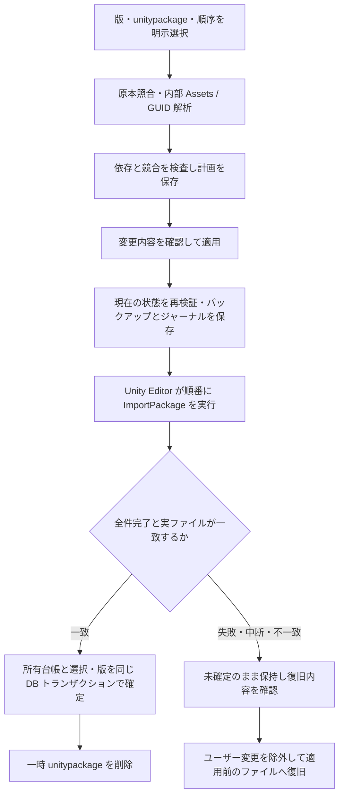

# Unity への適用

2026-11-17 に、本体の確認画面から Unity Editor、実ファイル照合、SQLite の適用実績までを接続した。単体の unitypackage と ZIP 内の明示選択を扱う。PNG / PSD の直接追加、配置先指定、Assets パスの変更は含まない。

## 使い方

1. 登録済みのプロジェクトを選択し、同じプロジェクトを Unity で開く。
2. ライブラリで原本の版と unitypackage を選び、適用順を決めて「適用内容を確認」を開く。ZIP は全体を展開しなくても選べる。
3. 初回は「Unity アダプターを導入」を実行し、Unity のコンパイル完了を待つ。既存の異なるアダプターは上書きしない。
4. 追加・版更新・選択変更、削除するファイル、インポート順を確認して「確認した内容を適用」を実行する。
5. 完了通知とファイル・GUID・ハッシュの一致を確認してから「適用完了」となる。

プロジェクト画面の「Unity への適用を管理」では、適用済みの版、パッケージ全体の削除、未完了ジョブと復旧を確認できる。ダイアログを閉じても本体の結果確認ワーカーは動作する。本体を終了しても要求・結果・ジャーナルを保持し、次回起動時に待機中ジョブの確認を再開する。準備中に終了したジョブは再実行せず、復旧内容の確認へ進む。

## 実装の境界

- Rust 共通 service が `buildInstallPlan / installItem / getInstallations / pollInstallation / recoverInstallation / setupUnityAdapter` を持つ。Tauri の入口は同じ command dispatcher と `UnityGateway` を使う。ネットワーク API を適用時に呼ばない。
- gzip / tar の unitypackage を展開せずに解析し、GUID ごとの pathname / asset / asset.meta を照合する。危険パス、リンク、特殊エントリ、重複、GUID 不一致、gzip CRC 不一致を拒否する。パスは Assets 配下に限定する。macOS の Unity が付ける `./`、時刻・拡張属性の PAX、AppleDouble はメタデータとして扱う。PAX によるパス・サイズ等の上書きは拒否する。原本と選択内容のハッシュは適用直前にも照合する。
- 内部解析は10万 tar エントリ・8 GiB、希望マニフェストは10万項目・内容合計8 GiBまで。既存 Assets の走査も10万項目まで。既存フォルダーの `.meta` の書き換えは、共有先を壊さないよう拒否する。既存・入力の大小文字の別名、パスと GUID の競合、ユーザー変更済みの所有ファイルを停止する。実ファイル照合は `.meta` も含めて厳密一致とし、Unity が書き換えた場合も成功扱いにしない。
- `baseStateHash` は Assets のファイルハッシュ・ディレクトリ・GUID、Unity の版、所有台帳、適用済み選択、依存定義を含む。`planHash` は原本、選択 ID・順序、内部マニフェスト、変更内容を含む保存済み計画を識別する。確認後の変化は `PLAN_STALE` で停止する。
- プロジェクト単位の OS ファイルロックと DB の未完了ジョブ一意制約を使う。同じ idempotency key と計画の再送は同じジョブを返す。別の計画へのキー流用は拒否する。
- `package_dependencies` の完全一致依存は保持するパッケージも含めて検証し、循環と欠損を拒否する。依存を先にし、版内では明示順に適用する。依存を暗黙に全選択しない。依存・共通カスタムを編集する UI は後続。
- 同じ版の再選択は追加した unitypackage だけをインポートし、外した選択が所有するファイルを削除する。順序だけの変更や全削除では空の Editor 要求で Refresh と完了を待つ。版更新では新しい選択をインポートする。
- 複合外部キーで版・論理パッケージ・元 unitypackage の所属を保証する。`project_packages / project_selections / project_files / install_jobs` の成功確定は一つのトランザクション。ZIP を後で永久展開しても選択 ID を保持する。
- Editor 拡張を埋め込み UPM パッケージとして `Packages/com.omnooth.editor/` に導入する。既存の異なる内容やリンクを上書きしない。Unity の5秒以内の heartbeat と idle 状態、前の要求の完了を確認してから Assets を変更する。完了通知後もコンパイル等の終了を待ってからファイル照合・成功確定へ進む。プレイ中・コンパイル中・他のインポート中は開始しない。
- 上書き・削除前にハッシュ照合済みバックアップを保存する。バックアップとジョブのジャーナルは `appData/install-backups/` と本体 DB に保持する。原本 ZIP は削除しない。一時 unitypackage は DB 成功確定後だけ `appData/install-staging/<planId>/` から削除する。
- 復旧は現在のハッシュが適用前または今回の予定内容に一致するファイルだけを戻す。ユーザー変更は競合として停止する。Editor の要求が未完了なら復旧しない。共有するフォルダー全体は削除せず、削除計画でもフォルダーの `.meta` は残す。新規フォルダーにユーザー作業が追加されている場合も `.meta` の削除を停止する。

## 検証と残る制約

- Rust の計画→実行→模擬 Editor→実ファイル照合→DB 確定・復旧を統合テストした。ZIP 選択順、部分再選択、版更新・全削除、依存、古い計画、再起動、二重送信、競合・ユーザー変更・リンク・不正アーカイブを含む。
- Playwright で確認前の実行防止、選択順、確認した planHash の実行、適用済み一覧と削除計画、Editor 不在からの再試行、未完了ジョブの復旧を確認した。
- macOS の Unity 2022.3.22f1 を一時プロジェクトで実行し、同梱 Editor アダプターの非対話 ImportPackage、要求・操作 ID、完了通知、実ファイル内容、GUID を確認した。Unity が書き出した元の asset / asset.meta とインポート後のバイトも一致した。自作のテキスト1ファイルの fixture であり、VRChat 商品全体、Prefab / Material 参照やドメインリロード中の復旧を確認したものではない。
- 実機テストは `python3 unity/tests/validate-editor.py --unity <Unity実行ファイル>` で再実行できる。ライセンスが必要。既存プロジェクトを使わず、検証用フォルダーとログの場所を表示する。Unity 由来の小さな回帰 fixture を `crates/omnooth-core/tests/fixtures/` に保存した。
- Windows / Linux の実 Unity と GitHub Actions はこの作業では実行していない。Tauri ネイティブ画面の操作は Playwright による IPC fixture と区別する。
- Unity がスクリプト等で管理対象外へ加えた変更を丸ごと巻き戻す仕組みではない。未知の途中状態・Unity によるファイル変換・壊れたメタデータは停止して手動確認を求める。省略された親フォルダーが未作成の場合も、Unity が未知の GUID を生成しないよう計画を拒否する。事前に Unity で親を用意するか、親の定義を含む unitypackage を使う。
- フォルダーの所有権共有、差分更新時の GUID 移動、ファイルとフォルダーの相互変換は自動調整しない。古い確認用 staging と成功済みバックアップの自動整理は後続。復旧では作成済みディレクトリそのものを一括削除しない。

本体以外の設計レビュー DB、承認履歴、Figma、既存の `dist/omnooth` は変更していない。
