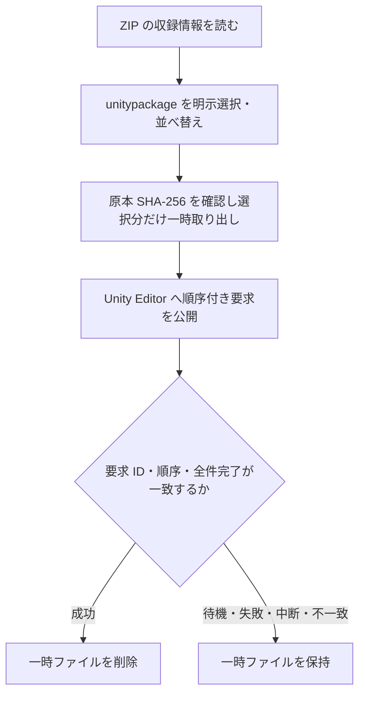

# ZIP の閲覧と Unity 用の一時取り出し

2026-11-06 の依頼に基づく実装。未展開でも ZIP の中身を確認し、Unity へ渡す unitypackage だけを一時的に取り出す。原本 ZIP は削除しない。

## 本体で利用できる範囲

ライブラリで未展開 ZIP の版を選ぶと `inspectArchive` が収録パス・種類・宣言サイズ・暗号化の有無を読み取る。ファイルの内容は解凍せず、DB の展開状態も変えない。画像・readme・フォルダーも一覧に表示し、パスで検索できる。一覧は100項目ずつ表示する。unitypackage の選択は初期状態では空で、選んだ順序を変更できる。

一覧のサイズは ZIP 内の宣言値。メンバーの SHA-256 を確認済みとは表示しない。取り出す際には保存原本の SHA-256 とメンバーの CRC・実サイズを確認し、取り出したファイルの SHA-256 を記録する。パストラバーサル、ドライブ指定、シンボリックリンク、特殊ファイル、重複・大小文字の別名、ファイルとディレクトリの衝突を拒否する。上限は10万項目・宣言合計8 GiB、実際の取り出しにも8 GiBの上限を設ける。

暗号化 ZIP の収録情報は読める場合に表示するが、パスワード入力・取り出しは未対応。ZIP 内の別の ZIP を再帰的に展開する機能は含まない。Unity に渡すファイルは unitypackage のみ。

## 独立 Unity アダプターの範囲

`prepare_zip_unity_import` は版 ID と明示順の収録 ID を受け取り、選択した unitypackage のみを `appData/unity-staging/<jobId>/<operationId>/` へ取り出す。収録名を展開先の階層として使わず、安全な basename のみを保持する。Unity の完了通知を識別できない同一 basename の組み合わせは取り出す前に拒否する。準備中の失敗では未公開の部分ファイルを削除する。

`start_zip_import` は要求を Editor へ公開し、`poll_zip_import` は結果を確認する。呼び出し側は待機中の job ID を継続して確認する。全件成功した場合だけ一時領域を削除する。失敗・キャンセル・不一致・結果不明では保持する。要求の公開エラーも、Editor が既に受け取った可能性を考慮して一時領域と job ID を保持する。再起動後も要求と結果が置き換えられる前であれば確認を再開できる。

本体の「適用」は未接続のまま。上記は ZIP 用の準備と独立アダプターの経路であり、planHash、内部 Assets / GUID の解析・競合検査、依存解決、バックアップ、所有台帳、実ファイルとの照合、DB 確定・復旧の完成を意味しない。Unity の callback は一時入力の削除判定に使うが、本体のインストール成功やロールバックの保証として扱わない。

## ローカル検証

- Rust: 非展開一覧、安定した収録 ID、選択した順序・ファイルのみの取り出し、原本保持、再起動後の一時領域の読み戻し、不正選択・パス・暗号化・原本改変・CRC 不一致の拒否。
- Unity アダプター: 待機・失敗・中断・別ジョブ・不完全な完了・公開要求の不一致では一時領域を保持し、正しい全件成功で削除する。削除後も次の要求を公開できることを模擬結果で確認する。
- Playwright: ZIP 収録内容の表示・検索、未選択からの選択・順序、暗号化メンバーの選択不可、読み込み失敗からの再試行、版切り替え後に遅延した応答を反映しないこと。全22件成功。
- TypeScript 型チェックと Vite のフロントビルド成功。pnpm 自体の署名検証がレジストリ通信で失敗したため、導入済み依存の同等 CLI を直接実行した。
- 最終の `cargo test --workspace --offline --quiet` は67件成功。OS の既定リンク受信先を書き換える既存の実機テスト1件は、従来どおり明示実行用として除外した。`cargo fmt --all -- --check` と `git diff --check` も成功。

Unity Editor による実インポートと削除の確認、Windows / Linux、GitHub Actions での実行結果は未確認。レビュー DB・承認履歴・Figma・既存の `dist/omnooth` は変更していない。
